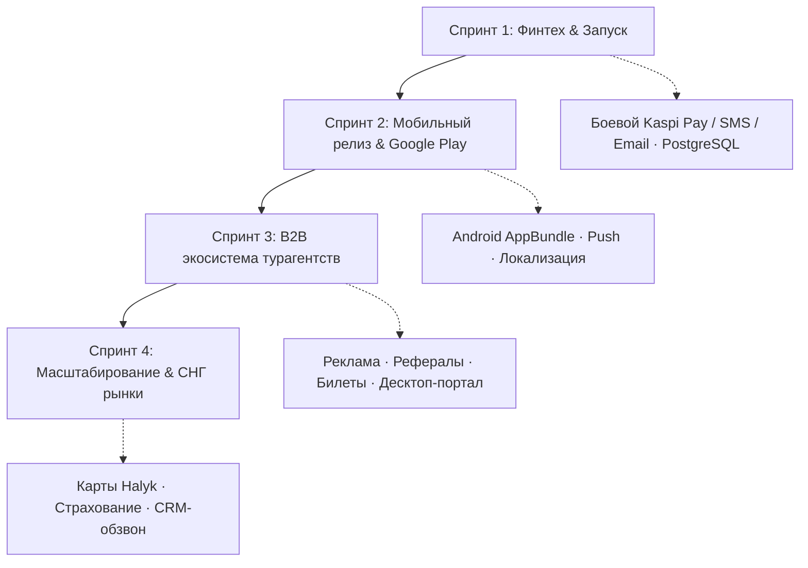

# 📋 Дорожная карта и трекер задач проекта SAPAR (Backlog & Roadmap)

> **Проект:** Sapar — национальный маркетплейс пакетных и авторских туров от турагентств Казахстана.
> **Репозиторий:** `https://github.com/abylhair123-beep/turfirm.git` (ветка `main`)
> **Стек:** Flutter 3 (Web, Android, iOS) + FastAPI & SQLAlchemy 2.0 (REST API) + PostgreSQL 16
> **Обозначения новых задач:** **[BE]** — бэкенд · **[FE]** — фронтенд · **[OPS]** — инфраструктура / организационное

---

## 🟢 ВЫПОЛНЕНО (MVP v1.0 + Эпики 2–5)

Базовые компоненты реализованы, протестированы и запушены в `main`:

| Задача | Модуль | Описание |
|---|:---:|---|
| **Авторизация и JWT** | Client / Backend | Экран входа/регистрации, JWT в `shared_preferences`, роли `client`, `agency`, `admin`. |
| **Каталог и поиск туров** | Client / Backend | Фильтрация по категориям, городам вылета, бюджету и текстовый поиск. |
| **Оформление бронирования** | Client / Backend | Расчёт стоимости (туродень × гости + сервисный сбор), сохранение брони в БД. |
| **Платежи Kaspi Pay (QR)** | Client / Backend | Генерация Kaspi QR, диплинки, эмуляция подтверждения и вебхук (sandbox). |
| **Мои бронирования** | Client | Список поездок со статусами, деталями и кнопкой отзыва. |
| **Избранное (Favorites)** | Client / Backend | Сердечки в карточках + отдельный экран избранного. |
| **Отзывы и рейтинги** | Client / Backend | Просмотр отзывов, отправка оценки 1–5 со звёздами (`POST /api/v1/reviews`). |
| **Медиа-хранилище** | Backend | S3 / MinIO и локальный upload изображений с валидацией (`backend/app/storage/`). |
| **Telegram & Email рассылки** | Backend | Уведомления турагентств в Telegram и квитанции на Email (`backend/app/notifications/`). |
| **Кабинет турагентства (B2B)** | Client / Backend | Создание тура с фото из галереи (`lib/screens/create_tour_screen.dart`). |
| **CI/CD** | DevOps | GitHub Actions: pytest, flutter analyze/test, сборка Web и Docker. |
| **PostgreSQL 16 & Docker** | Backend / DevOps | База на PostgreSQL 16 (docker-compose, healthcheck, том), `psycopg2-binary`, `pool_pre_ping`. |
| **Тестовое покрытие** | QA | 13 тестов `pytest` + 7 тестов `flutter test`. |

**Эпик 2 — Мобильный клиент (✅ готово):** Android release signing (Keystore, AppBundle) · push-уведомления (`NotificationService`) · локализация 🇰🇿/🇷🇺/🇬🇧 (`flutter_localizations`, `intl`) · полноэкранная галерея тура `PhotoGalleryViewer` с зумом.

**Эпик 3 — B2B кабинет (✅ готово):** «Мои туры» с редактированием (`PUT /api/v1/tours/{id}`) · пауза/снятие тура (`PATCH .../toggle-active`) · Kanban бронирований · выгрузка туристов в Excel (`app/agencies/excel_export.py`) · аналитика продаж, комиссия, средний чек (`lib/screens/agency_dashboard_screen.dart`).

**Эпик 4 — Документы (✅ готово):** PDF-ваучер с QR (`GET /api/v1/bookings/{id}/voucher.pdf`, ReportLab) · SMS OTP-авторизация (`app/auth/sms_service.py`, Mobizon / KazInfoTech / Twilio / Mock).

**Эпик 5 — DevOps (✅ готово):** `pg_dump` бэкапы в S3 (ротация 7 дней) · Redis-кэш туров/категорий с fallback · rate-limiting `slowapi` (брутфорс/парсинг) · мониторинг ошибок Sentry (FastAPI + Flutter).

---

## 🔴 СРОЧНО — дедлайн 20 ноября 2026: боевые ключи и платежи

Сейчас стоят заглушки (dev-режим) на оплате, SMS и Email. Нужны боевые учётки.
- [ ] **[OPS]** Получить боевые учётки: Kaspi Pay, SMS-провайдер, Email-рассылка.
- [ ] **[BE]** Kaspi: `KASPI_TEST_MODE=false` + боевые `KASPI_API_KEY` / `KASPI_MERCHANT_ID`.
- [ ] **[BE]** Kaspi: подпись вебхуков HMAC-SHA256 (`KASPI_WEBHOOK_SECRET`) + обработка возвратов (Refund).
- [ ] **[BE]** SMS: вставить боевой ключ провайдера, убрать dev-заглушку.
- [ ] **[BE]** Email: боевой SMTP / сервис рассылки, убрать dev-заглушку.
- [ ] **[BE]** Проверить «вживую»: реальную оплату, отправку SMS и письма.
> ❓ Уточнить: SMS-провайдер (Mobizon / SMSC?), Email (Gmail SMTP или SendGrid?), есть ли договор с Kaspi.

**Остальной финтех (Эпик 1, после дедлайна):**
- [ ] **[BE]** Эквайринг карт Visa/MasterCard (Halyk E-Pay / CloudPayments) + сохранение маски карты.
- [ ] **[BE]** Фискализация (ОФД / Webkassa): фискальный чек на email после оплаты.

---

## 🟢 НОВЫЕ ЗАДАЧИ — ЛЁГКИЕ (быстро, 1–2 места в коде)

### 17. «+Тур» только для турфирм
- [x] **[FE]** Скрыть кнопку «+Тур» для роли `user`, показывать только `agency`.
- [x] **[BE]** Проверка роли на `POST /api/v1/tours` (чтобы юзер не создал тур в обход).

### 1. Поиск с подсказками (как в Kaspi)
- [x] **[BE]** Эндпоинт автоподсказок `GET /api/v1/search/suggest?q=` (города, страны, отели, туры).
- [x] **[FE]** Живой выпадающий список подсказок под строкой поиска.
- [x] **[FE]** Недавние и популярные запросы.
- [x] **[BE]** Терпимость к опечаткам (ILIKE / триграммы `pg_trgm`).

### 15. Маркетинговые уловки
- [x] **[BE]** Поля тура: скидка, флаг «горящий» + дедлайн, кол-во оставшихся мест.
- [x] **[FE]** Бейджи «−30%», «Горящий тур» с таймером, «Осталось N мест».
- [x] **[BE]** Промокоды (модель + применение к брони).
- [x] **[FE]** Поле ввода промокода при бронировании.

---

## 🟡 НОВЫЕ ЗАДАЧИ — СРЕДНИЕ

### 2. Топовая фильтрация клиенту
- [x] **[BE]** Расширить модель тура: звёзды отеля, тип питания, линия пляжа, длительность.
- [x] **[BE]** Обновить сиды + фильтры в `GET /api/v1/tours` (query-параметры).
- [x] **[FE]** Экран фильтров: ⭐ звёзды · 🍽️ питание (всё включено…) · 🏖️ линия пляжа · цена · даты · люди · рейтинг.

### 16. Доработать аутентификацию (user / agency / admin)
- [x] **[BE]** Чёткое разграничение прав по ролям на всех защищённых ручках.
- [x] **[BE]** Восстановление пароля (через Email/SMS).
- [x] **[BE]** Подтверждение Email / телефона при регистрации.
- [x] **[FE]** Экраны: сброс пароля, ввод кода, корректный роутинг по роли.
> ℹ️ SMS OTP уже сделан (Эпик 4). Здесь — роли, сброс пароля, верификация email.
> ❓ Указать конкретные баги входа, которые есть сейчас.

### 5. Баланс / доход турфирмы
- [ ] **[BE]** Эндпоинты: баланс, история транзакций, заявка на вывод средств.
- [ ] **[FE]** Раздел «Финансы/Вывод» в кабинете агентства.
> ℹ️ Аналитика дохода, комиссия и средний чек уже есть (Эпик 3). Здесь — баланс и вывод средств.

### 7. Реферальные ссылки для блогеров
- [x] **[BE]** Модель реферала, генерация уникальной ссылки/кода.
- [x] **[BE]** Трекинг переходов и броней по ссылке, начисление вознаграждения.
- [x] **[FE]** Кабинет блогера/партнёра: сгенерировать ссылку + статистика.

### 6. Система рекламы
- [x] **[BE]** Флаг «продвигается» + ранжирование в выдаче, учёт оплаты рекламы.
- [x] **[FE]** Блок/бейдж «Реклама», поднятие проплаченных туров выше.
- [x] **[FE]** Экран покупки продвижения в кабинете агентства.
> ❓ Реклама туров внутри приложения или баннеры сторонних рекламодателей?

### 11. Админ-панель: баланс (приход / расход)
- [x] **[BE]** Агрегация финансов: приходы (оплаты, реклама) + расходы (выплаты агентствам, блогерам).
- [x] **[BE]** Админ-эндпоинты финансового отчёта.
- [x] **[FE]** Экран админки: приход, расход, итог.

### 8. Мед. страхование
- [ ] **[BE]** Опция страховки к туру (расчёт стоимости, сохранение в брони).
- [ ] **[FE]** Шаг «Добавить страховку» при бронировании.
> ℹ️ В ваучер уже вшита строка страховки (Эпик 4). Здесь — выбор и оплата страховки.
> ❓ Интеграция с реальной страховой или свой расчёт без внешнего API?

---

## 🔴 НОВЫЕ ЗАДАЧИ — СЛОЖНЫЕ / КРУПНЫЕ

### 4. Отдельный десктоп-портал для турфирм
- [ ] **[BE]** Полный набор B2B-эндпоинтов (туры, брони, финансы, профиль).
- [ ] **[FE]** Отдельный интерфейс для компаний (веб/десктоп), не мобильное приложение.
> ℹ️ B2B-кабинет есть в мобилке (Эпик 3). Здесь — отдельный десктоп/веб-портал.
> ❓ Flutter Web (отдельная сборка) или нативное desktop-приложение?

### 9. Билеты: авиа / ЖД (отдельное окно)
- [ ] **[BE]** Модуль билетов: поиск рейсов, бронирование.
- [ ] **[FE]** Отдельный раздел «Билеты»: поиск → выбор → оплата.
> ❓ Интеграция с агрегатором (Aviata / Chocotravel / Amadeus) или своя база рейсов?

### 10. Система обзвона клиентов и турфирм
- [x] **[BE]** Лог звонков, статусы, привязка к броням/клиентам (мини-CRM).
- [x] **[FE]** Интерфейс обзвона для менеджера / админа.
> ❓ Ручной обзвон (список + заметки) или автообзвон через IP-телефонию?

### 14. Сайт Sapar (лендинг)
- [ ] **[FE]** Отдельный сайт: о проекте, «скачать приложение», раздел для партнёров.
- [ ] **[BE]** (опц.) формы заявок / обратной связи.
> ❓ Только лендинг или заодно веб-версия приложения?

### 12. Кибербезопасность (чеклист, остаток)
- [ ] **[BE]** 2FA для админов и агентств.
- [ ] **[BE]** Доп. защита от XSS / SQL-инъекций, валидация ввода.
- [ ] **[OPS]** HTTPS, защита персональных данных, аудит-логи.
> ℹ️ Rate-limiting, Sentry и бэкапы БД уже сделаны (Эпик 5).

### 13. Аренда Mac (для iOS)
- [ ] **[OPS]** Арендовать облачный Mac (MacStadium / macincloud).
- [ ] **[OPS]** Сборка и публикация iOS-версии в App Store.

---

## 🗓️ План спринтов (Roadmap)



---

## 🚀 Запуск проекта

> Требуется запущенный PostgreSQL (контейнер `sapar_postgres`).

### Бэкенд (FastAPI + PostgreSQL)
```bash
# 1) база
cd backend && docker compose up -d postgres     # Postgres на порту хоста 5433

# 2) API (Windows — .venv; Linux — venv)
cd backend
uvicorn app.main:app --host 0.0.0.0 --port 8001 --reload
```
Swagger: **http://localhost:8001/docs**

### Фронтенд (Flutter Web)
```bash
flutter run -d chrome
```
