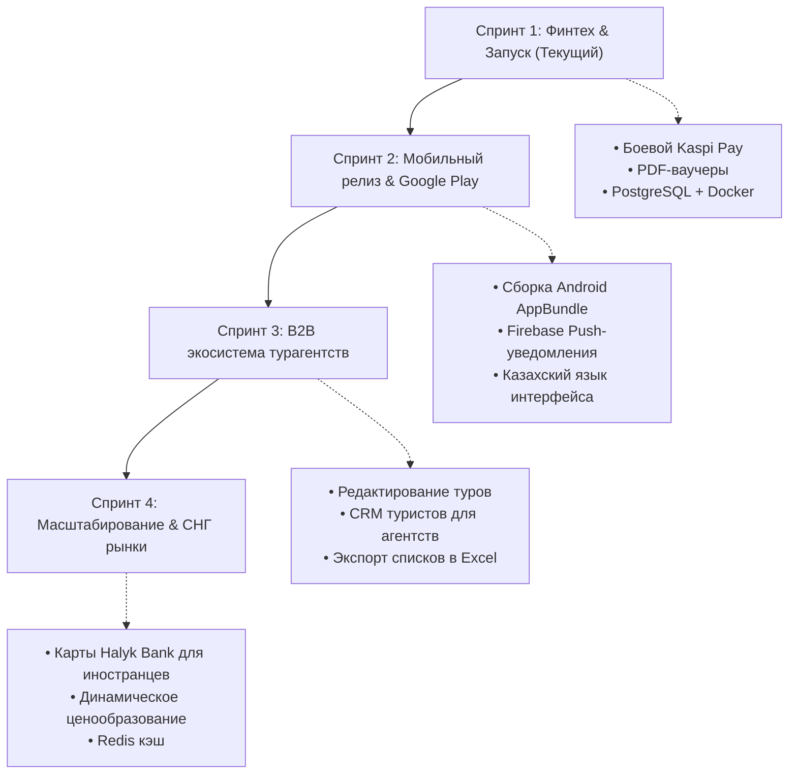

# 📋 Дорожная карта и трекер задач проекта SAPAR (Backlog & Roadmap)

> **Проект:** Sapar — национальный маркетплейс пакетных и авторских туров от турагентств Казахстана.  
> **Локальный путь:** `/home/aboka/Рабочий стол/project/sapar` (зеркало: `/home/aboka/Desktop/project/sapar`)  
> **Репозиторий:** `https://github.com/abylhair123-beep/turfirm.git` (ветка `main`)  
> **Стек:** Flutter 3 (Web, Android, iOS) + FastAPI & SQLAlchemy 2.0 (REST API) + SQLite / PostgreSQL  

---

## 🟢 1. ВЫПОЛНЕНО (MVP v1.0 — Ветка `main`)

Все базовые компоненты реализованы, протестированы, объединены и запушены в удаленный репозиторий:

| Задача | Модуль | Описание и реализация |
|---|:---:|---|
| **Авторизация и JWT** | Client / Backend | Экран входа/регистрации ([`lib/screens/auth_screen.dart`](file:///home/aboka/Desktop/project/sapar/lib/screens/auth_screen.dart)), сохранение JWT в `shared_preferences`, роли `client`, `agency`, `admin`. |
| **Каталог и поиск туров** | Client / Backend | Фильтрация по 5 категориям, городам вылета (Алматы, Астана, Шымкент), бюджету и текстовый поиск ([`lib/screens/search_screen.dart`](file:///home/aboka/Desktop/project/sapar/lib/screens/search_screen.dart)). |
| **Оформление бронирования** | Client / Backend | Расчет стоимости (туродень * гости + сервисный сбор 9 800 ₸), сохранение брони в БД ([`lib/screens/booking_screen.dart`](file:///home/aboka/Desktop/project/sapar/lib/screens/booking_screen.dart)). |
| **Платежи Kaspi Pay (QR)** | Client / Backend | Генерация Kaspi QR через `qr_flutter`, диплинки, эмуляция подтверждения и вебхук ([`lib/widgets/kaspi_qr_sheet.dart`](file:///home/aboka/Desktop/project/sapar/lib/widgets/kaspi_qr_sheet.dart)). |
| **Экран «Мои бронирования»** | Client | Список поездок со статусами (`paid`, `confirmed`, `pending`), деталями и кнопкой отзыва ([`lib/screens/bookings_list_screen.dart`](file:///home/aboka/Desktop/project/sapar/lib/screens/bookings_list_screen.dart)). |
| **Избранное (Favorites)** | Client / Backend | Интерактивные сердечки в карточках и отдельный экран любимых туров ([`lib/screens/favorites_screen.dart`](file:///home/aboka/Desktop/project/sapar/lib/screens/favorites_screen.dart)). |
| **Отзывы и рейтинги** | Client / Backend | Просмотр отзывов других туристов, отправка оценки 1–5 со звездами и комментарием (`POST /api/v1/reviews`). |
| **Медиа-хранилище (Storage)** | Backend | S3 / MinIO и локальный upload изображений с валидацией расширений ([`backend/app/storage/`](file:///home/aboka/Desktop/project/sapar/backend/app/storage)). |
| **Telegram & Email рассылки** | Backend | Модуль уведомлений турагентств в Telegram и отправка квитанций на Email ([`backend/app/notifications/`](file:///home/aboka/Desktop/project/sapar/backend/app/notifications)). |
| **Кабинет турагентства (B2B)** | Client / Backend | Создание тура с выбором фото из галереи, параметрами и выгрузкой в каталог ([`lib/screens/create_tour_screen.dart`](file:///home/aboka/Desktop/project/sapar/lib/screens/create_tour_screen.dart)). |
| **CI/CD Автоматизация** | DevOps | GitHub Actions workflows ([`.github/workflows/ci.yml`](file:///home/aboka/Desktop/project/sapar/.github/workflows/ci.yml) & [`cd.yml`](file:///home/aboka/Desktop/project/sapar/.github/workflows/cd.yml)). |
| **PostgreSQL 16 & Docker** | Backend / DevOps | База переведена на PostgreSQL 16 (docker-compose с healthcheck и томом данных), драйвер `psycopg2-binary`. |
| **Тестовое покрытие** | QA | 13 тестов `pytest` (бэкенд) + 7 тестов `flutter test` (фронтенд) — 100% успех. |

---

## 🎯 2. БЭКЛОГ ЗАДАЧ ПО НАПРАВЛЕНИЯМ (Sprint Backlog)

### 💳 Эпик 1: Платежные системы и Финтех (Payments & Fintech)
- [ ] **Боевой Kaspi Pay API:**
  - [ ] Замена тестового режима на боевой `KASPI_TEST_MODE=false`.
  - [ ] Реализация криптографической подписи вебхуков Kaspi через HMAC-SHA256 (`KASPI_WEBHOOK_SECRET`).
  - [ ] Обработка частичных и полных возвратов (Refund API) при отмене бронирования.
- [ ] **Эквайринг банковских карт (Halyk E-Pay / CloudPayments):**
  - [ ] Интеграция шлюза для оплаты картами Visa/MasterCard туристов без Kaspi.
  - [ ] Сохранение маски карты для повторных оплат.
- [ ] **Фискализация (ОФД / Webkassa):**
  - [ ] Автоматическая отправка фискального чека на email клиента после успешной оплаты.

### 📱 Эпик 2: Мобильное приложение и UX (Mobile Client)
- [x] **Android сборка:**
  - [x] Подготовка Keystore и signing конфигурации (`key.properties` & `android/app/build.gradle.kts`).
  - [x] Настройка Release Bundle и автоматический fallback для Google Play Store.
- [x] **Push-уведомления (Notifications System & In-App Alerts):**
  - [x] Сервис пуш-уведомлений `NotificationService` с анимированным баннером и журналом.
  - [x] Мгновенные пуши клиенту при подтверждении тура, успешной оплате и изменении статусов.
- [x] **Локализация (Qazaqsha / Русский / English):**
  - [x] Подключение `flutter_localizations` и `intl: ^0.20.3`.
  - [x] Переключатель языка интерфейса в профиле пользователя (🇰🇿 Қазақша, 🇷🇺 Русский, 🇬🇧 English) с сохранением в `SharedPreferences`.
- [x] **Галерея фотографий тура:**
  - [x] Поддержка списка фотографий (`List<String> photoUrls`) вместо одной.
  - [x] Полноэкранный слайдер `PhotoGalleryViewer` с зумом (pinch-to-zoom) на детальной странице тура.

### 🏢 Эпик 3: Портал турагентств и B2B кабинет (Agency Dashboard)
- [x] **Управление турами агентства:**
  - [x] Экран «Мои туры» с возможностью редактирования цен, дат и описания (`PUT /api/v1/tours/{id}`).
  - [x] Кнопка быстрой паузы/снятия тура с продажи (`is_active = false` / `PATCH /api/v1/tours/{id}/toggle-active`).
- [x] **Управление туристами и заявками:**
  - [x] Канбан/список бронирований агентства со сменой статусов: `Новая` ➔ `Подтверждена` ➔ `Выдан ваучер` ➔ `Завершена`.
  - [x] Выгрузка списка туристов в Excel (XLSX) для подачи списков в авиакомпании ([`app/agencies/excel_export.py`](file:///home/aboka/Desktop/project/sapar/backend/app/agencies/excel_export.py)).
- [x] **Аналитическая панель:**
  - [x] График продаж за неделю/месяц, сумма комиссионного вознаграждения, средний чек ([`lib/screens/agency_dashboard_screen.dart`](file:///home/aboka/Desktop/project/sapar/lib/screens/agency_dashboard_screen.dart) & `GET /api/v1/agencies/me/analytics`).

### 📄 Эпик 4: Документооборот и Клиентский сервис (Vouchers & Docs)
- [x] **Генерация PDF-ваучера поездки:**
  - [x] Эндпоинт `GET /api/v1/bookings/{id}/voucher.pdf` (генерация через `ReportLab` в [`app/bookings/voucher.py`](file:///home/aboka/Desktop/project/sapar/backend/app/bookings/voucher.py)).
  - [x] Включение в ваучер QR-кода проверки подлинности, контактных данных отеля, времени трансфера и страховки Nomad Insurance.
- [x] **Авторизация по номеру телефона через SMS:**
  - [x] Интеграция SMS-шлюза (Mobizon / KazInfoTech / Twilio / Mock) с отправкой 4-значного OTP-кода ([`app/auth/sms_service.py`](file:///home/aboka/Desktop/project/sapar/backend/app/auth/sms_service.py)).

### 🛡️ Эпик 5: Инфраструктура, Безопасность и Масштабирование (DevOps)
- [x] **Миграция БД на PostgreSQL (Выполнено):**
  - [x] Развертывание PostgreSQL 16 в Docker ([`backend/docker-compose.yml`](file:///home/aboka/Desktop/project/sapar/backend/docker-compose.yml)).
  - [x] Подключение пула соединений SQLAlchemy с `pool_pre_ping=True` и драйвером `psycopg2-binary`.
- [x] **Резервное копирование и кэширование:**
  - [x] Настройка бэкапов БД (`pg_dump` с gzip по расписанию в S3/MinIO, ротация 7 дней в [`scripts/backup_db.py`](file:///home/aboka/Desktop/project/sapar/backend/scripts/backup_db.py) и cron-сервис `db-backup` в Docker Compose).
  - [x] Кэширование популярных туров (10 мин) и категорий (15 мин) в Redis с graceful fallback и инвалидацией ([`app/core/cache.py`](file:///home/aboka/Desktop/project/sapar/backend/app/core/cache.py)).
- [x] **Защита и безопасность API:**
  - [x] Ограничение частоты запросов (Rate Limiting) через `slowapi` (защита от брутфорса на `/auth/login` и `/auth/register`, защита от парсинга на каталоге в [`app/core/limiter.py`](file:///home/aboka/Desktop/project/sapar/backend/app/core/limiter.py)).
  - [x] Мониторинг ошибок в реальном времени через Sentry (FastAPI middleware/SDK + Flutter [`SentryService`](file:///home/aboka/Desktop/project/sapar/lib/services/sentry_service.dart)).

---

## 🗓️ 3. ПЛАН СПРИНТОВ (Roadmap Releases)



---

## 🚀 4. БЫСТРЫЙ ЗАПУСК ДЛЯ РАЗРАБОТЧИКОВ

### 1. Бэкенд (FastAPI):
```bash
cd "/home/aboka/Рабочий стол/project/sapar/backend"
source venv/bin/activate
uvicorn app.main:app --host 0.0.0.0 --port 8000 --reload
```
- Swagger UI документация: **`http://localhost:8000/docs`**
- OpenAPI схема: **`http://localhost:8000/openapi.json`**

### 2. Фронтенд (Flutter Web):
```bash
cd "/home/aboka/Рабочий стол/project/sapar/build/web"
python3 serve.py
```
- Доступ с ПК и смартфонов в сети: **`http://192.168.10.12:5050`**

### 3. Запуск тестов:
```bash
# Бэкенд тесты
cd "/home/aboka/Рабочий стол/project/sapar/backend" && ./venv/bin/pytest tests -v

# Фронтенд анализ и тесты
cd "/home/aboka/Рабочий стол/project/sapar" && dart analyze . && flutter test
```
